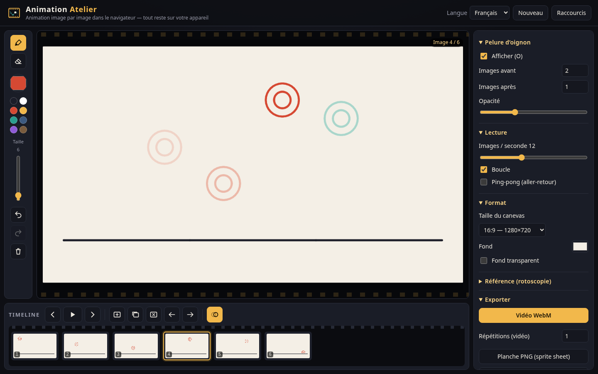
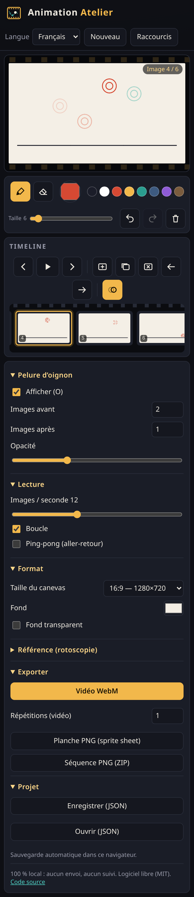

# Animation Atelier

Studio libre d’**animation image par image** dans le navigateur : flipbook, animation brute (*rough*), animatique, rotoscopie.
Pour animateurs, illustrateurs et cinéastes. **Gratuit, sans installation, sans compte, fonctionne hors ligne** — vos dessins ne quittent jamais votre appareil.

**Démo en ligne :** [https://salimadour31-boop.github.io/animation-atelier/](https://salimadour31-boop.github.io/animation-atelier/)



| Mobile (390 px) |
|---|
|  |

---

## Fonctionnalités

- **Dessin** à la souris, au doigt ou au **stylet avec pression** (Pointer Events, points intermédiaires « coalesced » pour des traits fluides) : pinceau, gomme, taille, sélecteur de couleur + nuancier, **annuler / rétablir par image**, effacer l’image.
- **Timeline** avec vignettes : ajouter, dupliquer, supprimer, déplacer à gauche / à droite, sélection par clic.
- **Pelure d’oignon** : images précédentes teintées en rouge, suivantes en turquoise, nombre (0–5 de chaque côté) et opacité réglables, activation en un clic ou avec <kbd>O</kbd>.
- **Lecture** de 1 à 30 images / seconde, **boucle** et **ping-pong** (aller-retour).
- **Formats** : 16:9 (1280×720), 1:1 (1080×1080), 9:16 (720×1280), 2.39:1 scope (1280×536) ; couleur de fond ou **fond transparent**.
- **Rotoscopie** : importez une **image ou une vidéo** comme calque de référence (opacité, position dans la vidéo, option « suivre l’image courante »), incluse ou non dans les exports.
- **Exports** : **vidéo WebM** (`canvas.captureStream` + `MediaRecorder`, avec message clair si le navigateur ne le permet pas), **planche PNG** (sprite sheet), **séquence PNG dans un ZIP** (petit écrivain ZIP « store » écrit pour ce projet, sans bibliothèque), **projet JSON** (enregistrer / ouvrir).
- **Sauvegarde automatique** dans le `localStorage` du navigateur.
- **Interface en français** (par défaut), **anglais** et **taqbaylit** (kabyle, alphabet latin).
- Responsive (ordinateur et mobile), libellés accessibles, thème sombre « salle de projection », logo SVG original.
- 100 % HTML / CSS / JavaScript, **sans build, sans dépendance, sans CDN**, aucune requête réseau, aucun suivi.

## Utilisation

1. Ouvrez la [démo](https://salimadour31-boop.github.io/animation-atelier/) (ou le fichier `index.html` du dépôt).
2. Dessinez la première image, puis **ajoutez** (<kbd>N</kbd>) ou **dupliquez** (<kbd>D</kbd>) une image : la pelure d’oignon montre les images voisines pour caler le mouvement.
3. Lancez la **lecture** (<kbd>Espace</kbd>) et ajustez la cadence (images / seconde), la boucle ou le ping-pong.
4. Pour la rotoscopie, ouvrez *Référence* et importez une image ou une vidéo.
5. **Exportez** en WebM, en planche PNG ou en séquence PNG (ZIP) — ou enregistrez le projet en JSON pour le reprendre plus tard.

## Raccourcis clavier

| Touche | Action |
|---|---|
| <kbd>←</kbd> / <kbd>→</kbd> | Image précédente / suivante |
| <kbd>Espace</kbd> | Lecture / pause |
| <kbd>B</kbd> | Pinceau |
| <kbd>E</kbd> | Gomme |
| <kbd>O</kbd> | Pelure d’oignon |
| <kbd>Ctrl</kbd>+<kbd>Z</kbd> / <kbd>Ctrl</kbd>+<kbd>Y</kbd> (ou <kbd>Ctrl</kbd>+<kbd>Maj</kbd>+<kbd>Z</kbd>) | Annuler / rétablir (image courante) |
| <kbd>N</kbd> / <kbd>D</kbd> | Ajouter / dupliquer une image |
| <kbd>[</kbd> / <kbd>]</kbd> | Taille du pinceau − / + |
| <kbd>?</kbd> | Aide des raccourcis |

## Confidentialité

Tout est calculé localement par le navigateur. Rien n’est téléversé, aucune statistique, aucun cookie. Le projet en cours et la langue sont gardés dans le `localStorage` de votre navigateur.

## Lancer en local

```
git clone https://github.com/salimadour31-boop/animation-atelier.git
cd animation-atelier
python3 -m http.server 8000     # puis http://localhost:8000
```

Ouvrir directement `index.html` fonctionne aussi.

## Structure

```
animation-atelier/
  index.html
  css/style.css
  js/core.js     ← logique pure : opérations sur les images, lecture, pelure d’oignon, planche, ZIP, JSON (aussi dans Node)
  js/i18n.js     ← textes FR / EN / Taqbaylit
  js/app.js      ← interface : dessin, timeline, lecture, exports, sauvegarde
  icons/icon.svg
  tests/         ← tests unitaires (Node) et tests d’interface (Playwright)
```

## Tests

```
node tests/core.test.js   # tests unitaires, sans dépendance
npm install               # installe Playwright (uniquement pour les tests d’interface)
npm test                  # tests unitaires + interface (ordinateur 1440×900 et mobile 390×844)
```

Les tests unitaires vérifient les opérations sur les images, l’ordre de lecture (boucle / ping-pong), la pelure d’oignon, la planche, le CRC-32, le ZIP (accepté par `unzip -t`), les traductions complètes dans les 3 langues et l’aller-retour du projet JSON. Les tests d’interface dessinent des traits, ajoutent / dupliquent / déplacent / suppriment des images, testent la pelure d’oignon, la lecture, les raccourcis, le changement de langue, les exports, la sauvegarde automatique, l’absence d’erreur console et de requête réseau, puis créent les captures d’écran. Ils tournent aussi dans GitHub Actions.

## Licence

[MIT](LICENSE) — © 2026 Amirouche Amwanes / [salimadour31-boop](https://github.com/salimadour31-boop). Code, interface, icônes et logo originaux ; polices système uniquement.

---

## English

**Animation Atelier** is a free, open-source **frame-by-frame animation studio** that runs entirely in your browser — for flipbooks, rough animation, animatics and rotoscoping. No install, no account, works offline; nothing leaves your device.

- **Draw** with mouse, touch or a **pressure-sensitive stylus**: brush, eraser, size, colour picker and swatches, **per-frame undo / redo**, clear frame.
- **Timeline** with thumbnails: add, duplicate, delete, move left / right.
- **Onion skin**: previous frames tinted red, next frames teal, adjustable count and opacity, toggle with <kbd>O</kbd>.
- **Playback** at 1–30 fps with **loop** and **ping-pong**.
- **Canvas presets** 16:9, 1:1, 9:16 and 2.39:1, background colour or transparent; **reference image or video frame** as a background layer for rotoscoping.
- **Export** a **WebM video** (MediaRecorder, feature-detected), a **PNG sprite sheet**, a **PNG sequence as a ZIP** (tiny store-only ZIP writer written from scratch) and **save / open the project as JSON**. **Autosave** to localStorage.
- **Shortcuts**: arrows (prev / next frame), Space (play / pause), B (brush), E (eraser), O (onion skin), Ctrl+Z / Ctrl+Y, N / D (add / duplicate), [ / ] (brush size), ? (help).
- UI in **French** (default), **English** and **Taqbaylit**; responsive, accessible labels, dark cinematic theme. Vanilla HTML / CSS / JS, no build step, no CDN, no network calls, no tracking.

**Live demo:** https://salimadour31-boop.github.io/animation-atelier/ — run locally with `python3 -m http.server`, test with `npm test`. MIT licence.

## Taqbaylit

**Animation Atelier** d ahil ilelli n usmussu *tugna s tugna* deg yiminig : suneɣ s uɣmuc neɣ s yimru, rnu tugniwin, sken taqcert n uẓalim, urar asmussu, sifeḍ s WebM, PNG neɣ ZIP. Baṭel, ulac asebded, yetteddu ula s war Internet — kullec yeqqim ɣur-k. Turagt MIT.

*Tasuqilt taqbaylit d tazwarut — ma tufiḍ tuccḍa, ṣeggem-itt (issue neɣ pull request).*
